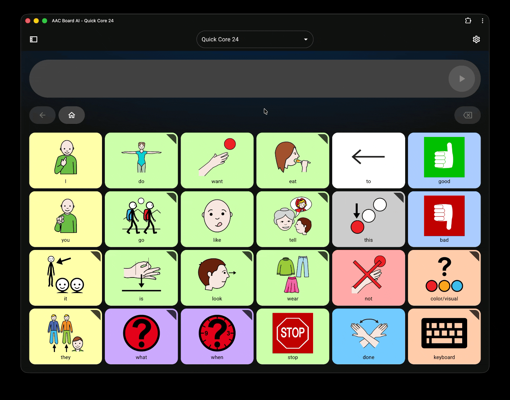

<div align="center">

# AAC Board AI

**Winner of the [Google Chrome Built-in AI Challenge 2025](https://developer.chrome.com/blog/ai-challenge-winners-2025) — Most Helpful Application**

**[Try AAC Board AI](https://aacboard.app)**

[](https://github.com/shayc/aac-board-ai/actions/workflows/ci.yml)

</div>

**AAC Board AI** is a free augmentative and alternative communication (AAC) app for people who cannot rely on speech, such as some autistic people and people with cerebral palsy, ALS, or aphasia. Users select symbols to build messages and have them spoken aloud. It runs in the browser, works offline, and needs no account.

On supported desktop browsers, **Built-in AI** uses the browser’s on-device models to proofread messages, suggest more complete phrasing, and translate board content. No API key or cloud AI service is required, and core communication works without Built-in AI.



## From tiles to a sentence

```text
Selected tiles:  [ want ] → [ eat ] → [ pizza ]
Board message:   "want eat pizza"
AI suggestion:   "I want to eat pizza."
```

Suggestions are optional and replace the original message only when accepted.

## Core features

- Optional on-device AI suggestions and board translation
- First Words starter board set for first-time AAC users
- Touch, keyboard navigation, and switch scanning with one or two switches
- Import [Open Board Format](https://www.openboardformat.org) files (`.obf` and `.obz`) from your device or a URL
- 35 interface languages, including right-to-left layouts
- Installable PWA with offline communication

## Privacy

No accounts, backend, or tracking. Boards and settings are stored on the device. URL imports, remote media, and some speech voices use the network.

## Limitations

Boards can be imported and stored, but not edited, exported, or synced across devices. Create custom boards in an Open Board Format-compatible tool, then import them on each device.

## Enable suggestions

To use suggestions on desktop, enable the following experimental flags for your browser:

**Google Chrome**

```text
chrome://flags/#proofreader-api
chrome://flags/#rewriter-api
```

**Microsoft Edge Canary or Dev**

Open `edge://flags`, search for `Proofreader API` and `Rewriter API`, and enable both flags.

Restart your browser to apply the changes. Suggestions need enough free disk space and memory to run on-device models. See the API documentation for current requirements:

- **Google Chrome:** [Proofreader](https://developer.chrome.com/docs/ai/proofreader-api) · [Rewriter](https://developer.chrome.com/docs/ai/rewriter-api) · [Translator](https://developer.chrome.com/docs/ai/translator-api)
- **Microsoft Edge:** [Proofreader](https://learn.microsoft.com/en-us/microsoft-edge/web-platform/proofreader-api) · [Rewriter](https://learn.microsoft.com/en-us/microsoft-edge/web-platform/writing-assistance-apis) · [Translator](https://learn.microsoft.com/en-us/microsoft-edge/web-platform/translator-api)

## Develop locally

Requires Node.js 24+.

```bash
git clone https://github.com/shayc/aac-board-ai.git
cd aac-board-ai
npm install
npm run dev
```

Open [http://localhost:5173](http://localhost:5173).

To run tests in Chromium and WebKit, install Playwright with `npx playwright install --with-deps`, then run `npm test`.

To measure performance locally, run `npm run perf`; see [docs/performance.md](docs/performance.md).

## Architecture

Built with React 19, TypeScript, Vite, and MUI.

- IndexedDB stores boards and assets; a service worker caches the app shell for offline use
- Behavior and accessibility tests run in Chromium and WebKit with Vitest and axe-core; Playwright verifies offline board loading in both engines in CI

The app uses [@shayc/open-board-format](https://github.com/shayc/open-board-format) to parse OBF/OBZ files and [@shayc/react-built-in-ai](https://github.com/shayc/react-built-in-ai) to manage browser AI availability and sessions.

See [docs/architecture.md](docs/architecture.md) for design decisions, data flow, and accessibility invariants.

## Contributing

Bug reports and feedback are welcome. The project has a single maintainer and limited capacity for code contributions.

## License

[MIT](LICENSE) © Shay Cojocaru

First Words symbols are from [Mulberry Symbols](https://mulberrysymbols.org), licensed under [CC BY-SA 4.0](https://creativecommons.org/licenses/by-sa/4.0/).

The bundled Quick Core boards are by [OpenAAC](https://www.openaac.org) and are licensed under [CC BY 4.0](https://creativecommons.org/licenses/by/4.0/).
