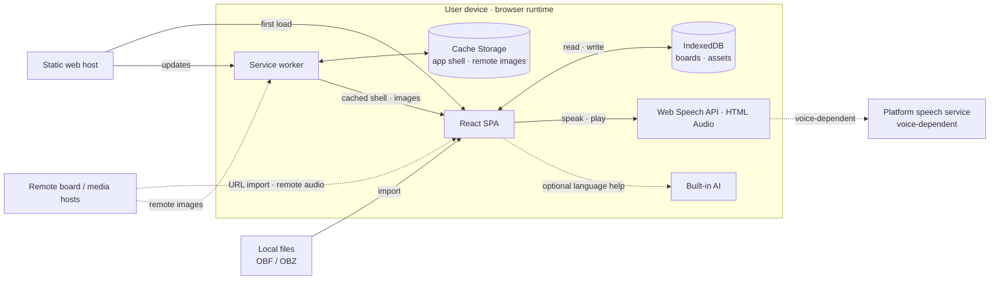
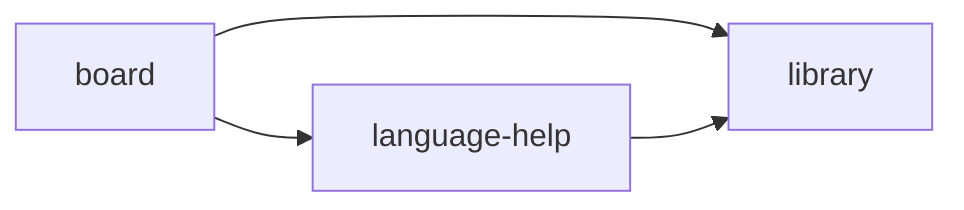

# Architecture

AAC Board AI is a device-local progressive web app (PWA) for people who cannot
rely on speech. Users select tiles to compose messages that the browser can
speak. The app uses React, TypeScript, Vite, MUI, and React Router. Built-in AI
provides optional, on-device language help.

Accessibility comes first, followed by offline reliability, privacy,
responsiveness, and internationalization. People rely on the app to communicate,
so optional features must never be required to read, navigate, or compose with a
loaded board.

See [README.md](../README.md) for product details and setup,
[AGENTS.md](../AGENTS.md) for contribution and testing rules, and the
[glossary](#glossary) for AAC terms.

- [Runtime architecture](#runtime-architecture)
- [Data and state ownership](#data-and-state-ownership)
- [Core flows](#core-flows)
- [Accessibility, language, and presentation](#accessibility-language-and-presentation)
- [Module boundaries and code map](#module-boundaries-and-code-map)
- [Current limitations](#current-limitations)
- [Glossary](#glossary)

## Runtime architecture

The app is a single-page application (SPA) with no application backend, telemetry,
or tracking. Keeping boards on-device protects communication content and supports
use on restricted networks; the trade-off is no built-in cross-device sync.

A static host serves the app and updates. The service worker caches the app shell
after the first successful load and third-party images as they are displayed.
Once the shell and board are available locally, core communication works offline.
Playback depends on locally available media and speech voices.

Dashed edges mark optional or platform-dependent integrations.

Built-in AI runs on-device without per-request network access once a model is
available. The app checks for AI capabilities directly rather than inferring
support from User-Agent strings.

## Data and state ownership

State has distinct owners and lifetimes:

| State                 | Owner                                 | Contents                                                                                               |
| --------------------- | ------------------------------------- | ------------------------------------------------------------------------------------------------------ |
| Durable board data    | IndexedDB through library storage     | Board-set metadata, source OBF records, and asset blobs                                                |
| Active board          | React Router loaders                  | Stored `Board`, and its set's board list and root board, for the current route                         |
| Asset URLs            | Board storage                         | One object URL per loaded asset, kept until board set deletion or page close                           |
| Navigation history    | React Router                          | Browser history with a flag allowing board Back navigation                                             |
| Reactive shared state | `createExternalStore`                 | Board-set library, board-set downloads, board translation status, voice catalog, and playback progress |
| Persisted preferences | `createPersistedStore` + localStorage | Language, speech, tile and message display, switch scanning, suggestion instructions, onboarding       |
| Interaction state     | Local React state                     | In-progress message parts and remembered grid focus                                                    |

Stored boards retain their OBF structure for AAC compatibility, preserving
imported fields while adding translations saved on this device. Board links
carry the linked board's ID, which the OBF library resolves from the archive. Board-set records keep their translated names alongside.
`obfToBoard` derives the runtime `Board` on each read, so runtime types can evolve
without rewriting stored records. Storage schema changes require a versioned
migration in [`boards-db.ts`](../src/features/library/storage/boards-db.ts).

React Context provides theme, playback controls, and snackbar access.
Components subscribe to external stores through `useExternalStore`, a
`useSyncExternalStore` wrapper that takes an optional selector.

Playback uses slice subscriptions: each component tracks only the progress fields
it needs. Word-boundary updates rerender only components whose selected fields
change.

The board-set library broadcasts changes so other tabs can refresh their lists.
Preferences managed by `createPersistedStore` do not synchronize across tabs. MUI
persists and synchronizes theme mode separately.

## Core flows

At `/`, a board URL supplied through `?board=` takes precedence: the app names the
link's host and imports only after the user confirms, because `/` opens the newest
board set and a link alone must not change it. URL downloads reject redirects to
another host, so the named host is the one that serves the file. Otherwise, the
app opens the first stored board set or imports the bundled starter board set if
the library is empty.

File selection, drag and drop, URL imports, and PWA file handling all use
`importBoardFile`. Each imported file creates a separate board set. The three
local-file entry points go through `useImportBoardFiles().importFiles`, which
skips files without a board file extension and reports when none remain. It
imports the rest one at a time, so a failing file doesn't block the others, and
reports the outcome in one message that names the file when exactly one fails.

Export is the reverse, for one set at a time from its library menu.
`boardSetToOBZ` packages the stored OBF records, which already carry the
translations saved on this device, with the set's stored assets. `createOBZ`
points board links at the boards it packages, media take the normalized path their file is stored under, and media whose file
was never stored drop their path and fall back to `data` or `url`. The set name, translated into the communication language, names the file.

### Open a board

Route loaders only read; they never translate or wait on a model:

1. Navigation to `/sets/:boardSetId/boards/:boardId` runs
   [`boardSetLoader`](../src/app/routing/loaders/board-set-loader.ts) for the
   header's board list and the set's root board, which Home navigates to
   (once per set, not per board), and
   [`boardLoader`](../src/app/routing/loaders/board-loader.ts), which calls
   `loadStoredBoard`. It reads the stored OBF, resolves object URLs for its
   stored assets, and maps both through `obfToBoard`. Loading leaves the OBF
   unchanged. Media paths resolve only to stored assets; otherwise the item's
   `data` or `url` is used.
2. The page renders the board in the communication language through
   `useBoardInLanguage`: the source board, or the board's own translations for
   that language, from the board file or saved on this device.

### Translate board sets

[`useBoardSetTranslation`](../src/features/language-help/translation/use-board-set-translation.ts)
runs in the app shell on start, on a language change, and when sets are added
or removed. Only a language change aborts the pass in progress; an added or
removed set queues another pass behind it, so a model download started by the
language change's user gesture is never cancelled. Each pass starts with the
set on screen, so that set never waits behind the rest.

For each set not yet in the communication language, it translates the set name
and every board missing that language, then saves them in one transaction.
Boards are checked one by one, because a set's language is only its root
board's. The set name comes from the root board's own translations when the
board file has them, so a set whose file ships every translation is named even
without the Translator API. A saved set name therefore marks the whole set as
translated, so later runs skip it without reading its boards. A set deleted
mid-translation is not written back.

After each saved set, it syncs the library and, when that set is on screen or
being navigated to, revalidates the routes (board and board list), so
everything on screen updates without a reload. Other sets are not revalidated:
that would re-run a `?board=` link import still in flight. A set the
translator fails on, for example because a model download needs a user
gesture, stays in its source language until the next run. A storage or other
error ends the pass and is reported, and passes queued behind it still run.

The hook hands each pass to the
[board translation coordinator](../src/features/language-help/translation/board-translation-coordinator.ts),
which owns the queue, the abort on a language change, and the board translation
status published while a pass is translating a set. The status is set when a set's model download starts or, with no download, once
its translation models are open, and cleared when the pass ends or the language
changes. A pass aborted by a language change never touches the status again. The
[board translation notice](../src/features/language-help/translation/board-translation-notice.tsx)
shows a model download first and the translation after it. The status is already
set when the download ends, so one alert carries both states.

Stored assets are immutable, so
[each asset has one object URL](../src/features/library/storage/asset-urls.ts) for
as long as its board set exists. Message parts keep their media after leaving
the board they came from. A library refresh revokes the URLs of deleted board
sets.

### Activate a tile

[`activateButton`](../src/features/board/activation/button-activator.ts)
coordinates message updates, navigation, and playback:

1. A tile linking to another board navigates immediately. A tile without actions
   appends a message part and plays it. Other tiles apply their actions in order.
2. A play action (OBF `:speak`) captures the message at that point. Changes
   from later actions, such as clearing the message, apply only if playback
   finishes uninterrupted. The played message stays visible during playback and
   is preserved if playback is interrupted.
3. The board playback adapter calls `planPlayback` to turn message parts into
   speech and recorded-audio steps. The shared coordinator plays them in order
   and publishes progress for highlighting.

Each new playback request interrupts the current one. These interruptions are
expected and do not surface as user errors.

## Accessibility, language, and presentation

### Accessibility

Controls have programmatic names and support pointer, keyboard, and switch input. The
[board grid](../src/features/board/grid/grid.tsx) and its
[keyboard behavior](../src/features/board/grid/use-grid-focus.ts) preserve
these rules:

- A populated grid has one Tab stop, at the remembered tile or first occupied
  cell.
- Arrow keys move between focusable cells; horizontal movement follows text
  direction.
- Home and End move to the first or last focusable cell in the row; with Ctrl
  or Cmd, in the grid.
- When grid content changes, focus returns to the remembered cell or first
  focusable tile only if no other control holds focus.

Behavior tests and axe-core accessibility checks run in real Chromium through
Playwright-backed Vitest.

### Switch scanning

People who cannot tap or use a keyboard select with one or two switches, which
arrive as the Space and Enter keys. Scanning is off until turned on in settings.
[`scanning/`](../src/features/board/scanning/) holds all of it:

- A scan group is any element spread with `scanGroupProps`; its items are the
  enabled buttons inside it. The board marks the message bar, the board
  controls, and each grid row. The
  [scanner](../src/features/board/scanning/switch-scanner.tsx) reads the groups
  from the DOM at every step, in document order, highlights the current group
  or item with an attribute, and clicks the selected one. Scanned controls therefore
  need no scanning code, and disabled controls and empty groups drop out by
  themselves.
- [`scan-sequence.ts`](../src/features/board/scanning/scan-sequence.ts) is the
  pure state machine: the scan moves through groups, selecting a group moves
  through its items, and selecting an item activates it. A group with one item
  activates it directly. After a group's last item the whole group is
  highlighted once more as an exit step; selecting it returns to the groups.
  Positions hold targets rather than indexes, so the board may change between
  steps.
- Automatic scanning moves on a timer and either switch selects. It starts on
  the first press, pauses after two passes over the groups, and moves on to the
  next group after two passes over a group's items. Two-switch step scanning moves
  with Space, selects with Enter, and keeps going around until a selection.
- Switch keys count wherever focus is, including on a header button, and are
  kept from the focused control. Keys typed into a text field are left alone,
  and so are keys pressed while a dialog, drawer, or menu covers the board.
  While scanning is on, Space and Enter therefore do not activate focused
  controls outside dialogs.
- A highlighted group outlines the enabled buttons it has now, so the outline
  follows buttons that are enabled, added, or replaced, such as when a folder
  tile opens another board into the same rows. When the highlighted group or
  item leaves the page, the scan restarts at the first group. The scan pauses
  while a dialog, drawer, or menu covers the board.
- Buttons that are disabled or not visible are not scanned. While a scan
  highlight shows, other controls hide their keyboard focus ring so only one
  control looks selected.

The app header, drawers, and dialogs are not scanned; they are for the person
setting up the device.

### Language and direction

The communication language setting coordinates UI locale, board translation,
text direction, and text-to-speech (TTS) voice selection. Language choices combine
UI locales and available voice languages. UI text, board translation, and speech
fall back independently, so selecting a language does not guarantee a matching
voice or translation model. Speech uses the saved voice only when it speaks
the communication language; otherwise it picks one of that language's voices,
or leaves the choice to the browser, without changing the saved voice.

Paraglide message catalogs provide UI text. Direction-specific Emotion caches,
right-to-left (RTL) styling, and logical CSS support both text directions.

### Theming

Theme colors are defined centrally in
[`theme-colors.ts`](../src/shared/theme/theme-colors.ts). Theme mode is set before
the first paint to avoid a flash of the wrong color scheme.

### Board spacing

The board places its bars, and the grid pads itself, with the spacing in
[`board-spacing.ts`](../src/features/board/board-spacing.ts), so the space
between any two of them changes in one place. Two values exist for each side of
the `sm` breakpoint: the page margin and the scroll clearance. The grid's
padding is derived from them in the same file, so the grid itself knows nothing
about the bars around it.

- The bars above the grid sit one page margin apart. The board keeps the scroll
  clearance above and below the grid at every size, whether a bar or the
  screen's edge is next to it. The grid pads its top and bottom by the page
  margin minus that clearance, so its first and last rows are one page margin
  from whatever is next to them, the same as its sides.
- The grid's
  [layout](../src/features/board/grid/grid-layout.ts) takes a padding for each
  axis and one overflow hint. Changing a padding does not change the hint.
- The grid's viewport sets its scroll padding to half the inset of an axis that
  scrolls. A row or column at rest, and a tile scrolled in because it took
  focus, sit that far from the edge with the same hint of both neighbors.
- Where the scroll rests at its start or end and a hint shows next to a bar, the
  space between that bar and the nearest whole row is the clearance, the
  overflow hint, and one tile gap. Making one of the three smaller is the only
  way to make that space smaller. Mid-scroll the space is the clearance plus the
  scroll padding, which is smaller wherever the grid's padding is less than a
  gap plus the hint.

## Module boundaries and code map

Cross-boundary imports use path aliases. Oxlint enforces these dependency rules
for aliased imports:

- `src/shared/` is the leaf layer and does not import from app, pages, or features.
- Each directory directly under `src/features/` is a feature. It imports shared
  code, its own relative modules, and the public entry points of the features
  it is allowed to depend on, but never app, pages, or another feature's
  internals.
- `src/app/` and `src/pages/` compose features through public entry points such as
  [`src/features/board/index.ts`](../src/features/board/index.ts).
- Only the library's [`storage/`](../src/features/library/storage/) imports `idb`
  or uses the `indexedDB` global, so every other module reaches stored boards
  through the library's public entry point.

The three features depend on each other in one direction:

| Feature                                           | Owns                                                                 | May import                 |
| ------------------------------------------------- | -------------------------------------------------------------------- | -------------------------- |
| [`board`](../src/features/board/)                 | Using a board: grid, tiles, message, activation, playback, scanning  | `language-help`, `library` |
| [`language-help`](../src/features/language-help/) | Optional built-in AI: suggestions and board translation              | `library`                  |
| [`library`](../src/features/library/)             | Stored board sets: storage, import, export, OBF mapping, board paths | no other feature           |

The board reaches suggestions only through language help's public entry point,
and nothing in the library depends on language help, so a board loads and
renders with no built-in AI code on its path. The board's own translations,
from the board file or saved on this device, are read by the library's
[`board-translations.ts`](../src/features/library/translations/board-translations.ts);
only producing new ones needs language help.

Test files may also import the `testing` entry of a feature they are allowed to
depend on, such as
[`src/features/library/testing/`](../src/features/library/testing/index.ts).
The runtime `Board` types are used by all three features and live in
[`shared/board/board-types.ts`](../src/shared/board/board-types.ts).

Inside a feature, folders group related code and collaborate through relative
imports; they are not separate boundaries.

### Settings composition

The [settings drawer](../src/app/settings/settings-drawer.tsx) composes
[tile settings](../src/features/board/tile/tile-settings.tsx),
[message settings](../src/features/board/message/message-settings.tsx),
[suggestion settings](../src/features/language-help/suggestions/suggestion-settings.tsx), and
[scanning settings](../src/features/board/scanning/scanning-settings.tsx)
through feature public entry points. The app owns headings, order, layout, and
drawer behavior; features own controls, capability checks, and persisted
preferences. App-wide language, theme, and speech settings live in `app/settings/`;
language settings render language help's
[board translation notice](../src/features/language-help/translation/board-translation-notice.tsx)
instead of checking Translator support or translation progress themselves. Reusable field controls live in
`shared/ui/` so features do not depend on the app layer.

Closing or unmounting settings does not delete preferences. Removing a feature
requires an explicit decision about retaining or deleting its persisted
preferences.

### Features

Start with `communication-board.tsx` to follow the board UI. Paths in this table
are relative to `src/features/`.

| Area                   | Source                                                                                                                                             | Responsibility                                                                   |
| ---------------------- | -------------------------------------------------------------------------------------------------------------------------------------------------- | -------------------------------------------------------------------------------- |
| Board interaction      | [board/communication-board.tsx](../src/features/board/communication-board.tsx)                                                                     | Compose the board UI and interaction adapters.                                   |
| Board playback         | [board/playback/](../src/features/board/playback/)                                                                                                 | Plan board playback and highlighting; delegate device output to shared code.     |
| Switch scanning        | [board/scanning/](../src/features/board/scanning/)                                                                                                 | Scan the board's controls with one or two switches; own scanning preferences.    |
| Import and OBF mapping | [library/import/](../src/features/library/import/), [library/obf/](../src/features/library/obf/)                                                   | Unify imports and map OBF records to runtime types.                              |
| Export                 | [library/export/](../src/features/library/export/)                                                                                                 | Package a stored board set as an OBZ file.                                       |
| Board persistence      | [library/storage/](../src/features/library/storage/)                                                                                               | Own all production IndexedDB access.                                             |
| Board-set library      | [library/board-sets/](../src/features/library/board-sets/)                                                                                         | Maintain the reactive library and coordinate board-set creation and deletion.    |
| Stored translations    | [library/translations/](../src/features/library/translations/)                                                                                     | Show a board in the communication language from the translations it already has. |
| Optional language help | [language-help/suggestions/](../src/features/language-help/suggestions/), [language-help/translation/](../src/features/language-help/translation/) | Enable suggestion models, apply rewrite instructions, and translate board text.  |

### App and shared code

Paths in this table are relative to `src/`.

| Area                   | Source                                                                                                                                             | Responsibility                                            |
| ---------------------- | -------------------------------------------------------------------------------------------------------------------------------------------------- | --------------------------------------------------------- |
| App composition        | [main.tsx](../src/main.tsx), [app/](../src/app/), [pages/](../src/pages/), [shared/providers/](../src/shared/providers/)                           | Assemble providers, shell, routing, and features.         |
| Device output          | [shared/playback/](../src/shared/playback/)                                                                                                        | Own all Web Speech and HTML Audio output.                 |
| Communication language | [shared/language/](../src/shared/language/), [shared/speech/](../src/shared/speech/)                                                               | Coordinate communication language and voice selection.    |
| Theme and direction    | [shared/theme/](../src/shared/theme/)                                                                                                              | Apply theme and directional styling.                      |
| Shared stores          | [shared/state/external-store.ts](../src/shared/state/external-store.ts), [shared/state/persisted-store.ts](../src/shared/state/persisted-store.ts) | Provide subscription and settings persistence primitives. |

At the repository root, [messages/](../messages/) holds UI catalogs and
[project.inlang/](../project.inlang/) configures Paraglide, which compiles them into
generated `src/paraglide/` modules.

### Companion packages

The app delegates OBF/OBZ parsing to
[`@shayc/open-board-format`](https://github.com/shayc/open-board-format) and browser
AI availability, provisioning, and session lifecycle to
[`@shayc/react-built-in-ai`](https://github.com/shayc/react-built-in-ai).

## Current limitations

- **AI availability varies.** Support depends on browser, hardware, model
  installation, and language.
- **Boards cannot be edited or synced.** There is no editor or cross-device
  sync. Moving boards between devices means exporting each board set as an OBZ
  file and importing it on the other device.
- **Speech may use external services.** Offline availability and privacy depend
  on the selected voice.
- **Remote media has limited offline support.** Cached third-party images may be
  evicted under storage pressure. Third-party audio remains network-dependent
  because the current cache strategy cannot reliably serve range requests using
  opaque cross-origin responses.

## Glossary

- **AAC** — Augmentative and Alternative Communication: tools for people who
  cannot rely on speech.
- **OBF / OBZ** — Open Board Format: a single board (`.obf`, JSON) or a zipped
  board set with assets (`.obz`).
- **Board** — a grid of communication tiles.
- **Board set** — a collection of linked boards with a root board, imported as a
  unit.
- **Library** — the board sets stored on this device, listed alongside bundled
  board sets that can be downloaded.
- **Symbol** — an AAC representation displayed on a tile or in the message bar:
  an image, a written label, or both.
- **Tile** — an interactive board button containing a communication symbol. It
  adds to the message, navigates to a linked board, or runs an action.
- **Button** — the data model behind a tile, named after the OBF button. Code uses
  `BoardButton` for the data and `Tile` for the view.
- **Vocalization** — the text a tile speaks when it differs from its visible label.
- **Board strings** — a board's translatable text: its name and each tile's label
  and vocalization. OBF keeps their translations in `strings`, one map per locale.
- **Message bar** — the area showing selected symbols that form the message to
  speak.
- **Page margin** — the space between the screen's edges and the board's
  content, and between one bar and the next.
- **Scroll clearance** — the room kept above and below the grid, between the
  tiles scrolling past and a bar's controls or the screen's edge.
- **Overflow hint** — the part of the next row or column that shows past the
  grid's edge, so the user can tell the board scrolls that way.
- **Inset** — the part of the grid's viewport that whole rows or columns leave
  free: padding, plus a tile gap and the overflow hint where the grid scrolls.
- **Message part** — one item in the message, with its own label and any
  vocalization, image, or sound.
- **Built-in AI** — browser-provided on-device Proofreader, Rewriter, and
  Translator APIs used for grammar, tone, and translation.
- **TTS** — text-to-speech through the browser's Web Speech API.
