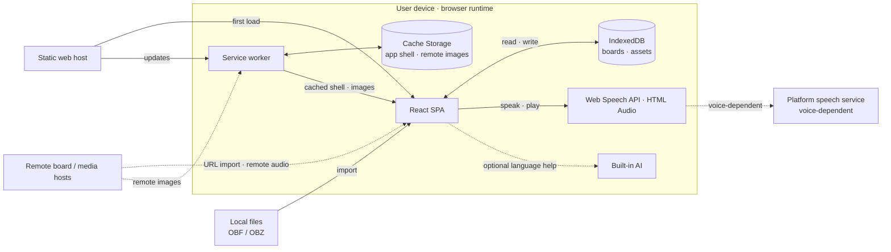

# Architecture

AAC Board AI is a device-local progressive web app (PWA) for people who cannot
rely on speech. Users select tiles to compose messages that the browser can
speak. The app uses React, TypeScript, Vite, MUI, and React Router. Built-in AI
provides optional, on-device language help.

Accessibility comes first, followed by offline reliability, privacy,
responsiveness, and internationalization. People rely on the app to communicate,
so optional features must never be required to read, navigate, or compose with a
loaded board.

See [README.md](../README.md) for product details and setup,
[AGENTS.md](../AGENTS.md) for contribution and testing rules, and the
[glossary](#glossary) for AAC terms.

- [Runtime architecture](#runtime-architecture)
- [Data and state ownership](#data-and-state-ownership)
- [Core flows](#core-flows)
- [Accessibility, language, and presentation](#accessibility-language-and-presentation)
- [Module boundaries and code map](#module-boundaries-and-code-map)
- [Current limitations](#current-limitations)
- [Glossary](#glossary)

## Runtime architecture

The app is a single-page application (SPA) with no application backend, telemetry,
or tracking. Keeping boards on-device protects communication content and supports
use on restricted networks; the trade-off is no built-in cross-device sync.

A static host serves the app and updates. The service worker caches the app shell
after the first successful load and third-party images as they are displayed.
Once the shell and board are available locally, core communication works offline.
Playback depends on locally available media and speech voices.

Dashed edges mark optional or platform-dependent integrations. URL imports and
remote media contact their source hosts; some speech voices use external
services.

Built-in AI runs on-device without per-request network access once a model is
available. The app checks for AI capabilities directly rather than inferring
support from User-Agent strings.

## Data and state ownership

State has distinct owners and lifetimes:

| State                 | Owner                                 | Contents                                                                     |
| --------------------- | ------------------------------------- | ---------------------------------------------------------------------------- |
| Durable board data    | IndexedDB through board storage       | Board-set metadata, source OBF records, and asset blobs                      |
| Active board          | React Router loaders                  | Hydrated, optionally translated `Board` for the current route                |
| Navigation history    | React Router `location.state`         | Bounded board back-stack                                                     |
| Reactive shared state | `createExternalStore`                 | Board-set catalog, voice catalog, and playback progress                      |
| Persisted settings    | `createPersistedStore` + localStorage | Language, speech, board preferences, suggestion instructions, and onboarding |
| Interaction state     | Local React state                     | In-progress message parts and remembered grid focus                          |

Stored boards retain their OBF structure for AAC compatibility, preserving
imported fields while adding resolved board links and cached translations.
`obfToBoard` derives the runtime `Board` on each read, so runtime types can evolve
without rewriting stored records. Storage schema changes require a versioned
migration in [`boards-db.ts`](../src/features/board/storage/boards-db.ts).

React Context provides language, theme, playback controls, and snackbar access.
Components subscribe to external stores through `useSyncExternalStore`.

Playback uses slice subscriptions: each component tracks only the progress fields
it needs. Word-boundary updates rerender only components whose selected fields
change.

The board-set catalog broadcasts changes so other tabs can refresh their lists.
Settings managed by `createPersistedStore` do not synchronize across tabs. MUI
persists and synchronizes theme mode separately.

## Core flows

At `/`, a board URL supplied through `?board=` takes precedence. Otherwise, the app
opens the first stored board set or imports the bundled starter board if the
catalog is empty.

File selection, drag and drop, URL imports, and PWA file handling all use
`importBoardSets`. Each imported file creates a separate board set.

### Open a board

[`boardLoader`](../src/app/routing/loaders/board-loader.ts) handles hydration and
translation before rendering, keeping that work out of UI components:

1. Navigation to `/sets/:setId/boards/:boardId` calls `hydrateBoard`, which reads
   the stored OBF and assets, creates media object URLs for the load, and maps the
   result through `obfToBoard`.
2. `resolveBoardForLanguage` uses the source board or a cached translation when
   possible. Otherwise, it attempts translation and falls back to the source
   board on failure. Successful translations render without waiting for the cache
   write and remain usable if it fails.
3. The route renders the `Board`. The app shell's
   [media lifecycle observer](../src/app/routing/use-sync-board-media-with-route.ts)
   takes ownership of the new media URLs and revokes the previous board's URLs.

Failed or aborted loads revoke their own URLs without affecting the active board.
Leaving the board route revokes the active board's URLs.

### Activate a tile

[`activateButton`](../src/features/board/activation/button-activation.ts)
coordinates message updates, navigation, and playback:

1. A tile linking to another board navigates immediately. A tile without actions
   appends a message part and plays it. Other tiles apply their actions in order.
2. A speak action captures the message at that point. Changes from later actions,
   such as clearing the message, apply only if playback finishes uninterrupted.
   The spoken message stays visible during playback and is preserved if playback
   is interrupted.
3. The board playback adapter calls `planPlayback` to turn message parts into
   speech and recorded-audio steps. The shared coordinator plays them in order
   and publishes progress for highlighting.

Each new playback request interrupts the current one. These interruptions are
expected and do not surface as user errors.

## Accessibility, language, and presentation

Controls have programmatic names and support pointer and keyboard input. The
[board grid](../src/features/board/grid/grid.tsx) and its
[keyboard behavior](../src/features/board/grid/use-grid-keyboard.ts) preserve
these rules:

- A populated grid has one Tab stop, at the remembered tile or first occupied
  cell.
- Arrow keys move between focusable cells; horizontal movement follows text
  direction.
- When grid content changes, focus returns to the remembered cell or first
  focusable tile only if no other control holds focus.

Behavior tests and axe-core accessibility checks run in real Chromium through
Playwright-backed Vitest.

The communication language setting coordinates UI locale, board translation,
text direction, and text-to-speech (TTS) voice selection. Language choices combine
UI locales and available voice languages. UI text, board translation, and speech
fall back independently, so selecting a language does not guarantee a matching
voice or translation model.

Paraglide message catalogs provide UI text. Direction-specific Emotion caches,
right-to-left (RTL) styling, and logical CSS support both text directions. The
[glossary](#glossary) keeps domain terms consistent across visible text and
accessible labels.

Theme colors are defined centrally in
[`theme-colors.ts`](../src/shared/theme/theme-colors.ts). Theme mode is set before
the first paint to avoid a flash of the wrong color scheme.

## Module boundaries and code map

Cross-boundary imports use path aliases. Oxlint enforces these dependency rules
for aliased imports:

- `src/shared/` is the leaf layer and does not import from app, pages, or features.
- Each directory directly under `src/features/` is isolated. It imports shared
  code and its own relative modules, but not app, pages, or other features.
- `src/app/` and `src/pages/` compose features through public entry points such as
  [`src/features/board/index.ts`](../src/features/board/index.ts).

Inside the board feature, folders group related code and collaborate through
relative imports; they are not separate feature boundaries.

### Settings composition

The [settings drawer](../src/app/settings/settings-drawer.tsx) explicitly composes
settings components exported by features. The app owns section headings, order,
layout, and drawer behavior; each feature owns its controls, capability checks,
and persisted preferences. Board settings live in
[`board-settings.tsx`](../src/features/board/board-settings.tsx), and suggestion
settings live beside their store in
[`suggestions/`](../src/features/board/suggestions/). App-wide language, theme,
and speech settings remain in `app/settings/`. Reusable field controls live in
`shared/ui/` so features do not depend on the app layer.

Add or remove a feature's settings through its public entry point and the drawer's
composition. Removing a feature also requires an explicit decision about any
persisted preferences; closing or unmounting settings does not delete them.

### Board feature

Start with `communication-board.tsx` to follow the board UI. Paths in this table
are relative to `src/features/board/`.

| Area                   | Source                                                                                                 | Responsibility                                                                   |
| ---------------------- | ------------------------------------------------------------------------------------------------------ | -------------------------------------------------------------------------------- |
| Board interaction      | [communication-board.tsx](../src/features/board/communication-board.tsx)                               | Compose the board UI and interaction adapters.                                   |
| Import and OBF mapping | [import/](../src/features/board/import/), [obf/](../src/features/board/obf/)                           | Unify imports and map OBF records to runtime types.                              |
| Board persistence      | [storage/](../src/features/board/storage/)                                                             | Own all production IndexedDB access.                                             |
| Board-set catalog      | [board-sets/](../src/features/board/board-sets/)                                                       | Maintain the reactive catalog and coordinate board-set creation and deletion.    |
| Board playback         | [playback/](../src/features/board/playback/)                                                           | Plan board playback and highlighting; delegate device output to shared code.     |
| Optional language help | [suggestions/](../src/features/board/suggestions/), [translation/](../src/features/board/translation/) | Prepare suggestion models, apply rewrite instructions, and translate board text. |

### App and shared code

Paths in this table are relative to `src/`.

| Area                   | Source                                                                                                                                             | Responsibility                                            |
| ---------------------- | -------------------------------------------------------------------------------------------------------------------------------------------------- | --------------------------------------------------------- |
| App composition        | [main.tsx](../src/main.tsx), [app/](../src/app/), [pages/](../src/pages/), [shared/providers/](../src/shared/providers/)                           | Assemble providers, shell, routing, and features.         |
| Device output          | [shared/playback/](../src/shared/playback/)                                                                                                        | Own all Web Speech and HTML Audio output.                 |
| Communication language | [shared/language/](../src/shared/language/), [shared/speech/](../src/shared/speech/)                                                               | Coordinate communication language and voice selection.    |
| Theme and direction    | [shared/theme/](../src/shared/theme/)                                                                                                              | Apply theme and directional styling.                      |
| Shared stores          | [shared/state/external-store.ts](../src/shared/state/external-store.ts), [shared/state/persisted-store.ts](../src/shared/state/persisted-store.ts) | Provide subscription and settings persistence primitives. |

At the repository root, [messages/](../messages/) holds UI catalogs and
[project.inlang/](../project.inlang/) configures Paraglide, which compiles them into
generated `src/paraglide/` modules.

### Companion packages

Two companion packages handle file formats and browser AI:
[`@shayc/open-board-format`](https://github.com/shayc/open-board-format) parses
and creates OBF/OBZ files, while
[`@shayc/react-built-in-ai`](https://github.com/shayc/react-built-in-ai) manages
browser AI availability, provisioning, and lifecycle. The app determines when and
how these capabilities are used.

## Current limitations

- **AI availability varies.** Support depends on browser, hardware, model
  installation, and language.
- **Boards are import-only.** There is no editor, export, or cross-device sync.
  Moving boards between devices requires the original OBF/OBZ files; cached
  translations cannot be exported.
- **Speech may use external services.** Offline availability and privacy depend
  on the selected voice.
- **Remote media has limited offline support.** Cached third-party images may be
  evicted under storage pressure. Third-party audio remains network-dependent
  because the current cache strategy cannot reliably serve range requests using
  opaque cross-origin responses.

## Glossary

- **AAC** — Augmentative and Alternative Communication: tools for people who
  cannot rely on speech.
- **OBF / OBZ** — Open Board Format: a single board (`.obf`, JSON) or a zipped
  board set with assets (`.obz`).
- **Board** — a grid of communication tiles.
- **Board set** — a collection of linked boards with a root board, imported as a
  unit.
- **Symbol** — an AAC representation displayed on a tile or in the message bar:
  an image, a written label, or both.
- **Tile** — an interactive board button containing a communication symbol. It
  adds to the message, navigates to a linked board, or runs an action.
- **Vocalization** — the text a tile speaks when it differs from its visible label.
- **Message bar** — the area showing selected symbols that form the message to
  speak.
- **Built-in AI** — browser-provided on-device Proofreader, Rewriter, and
  Translator APIs used for grammar, tone, and translation.
- **TTS** — text-to-speech through the browser's Web Speech API.
