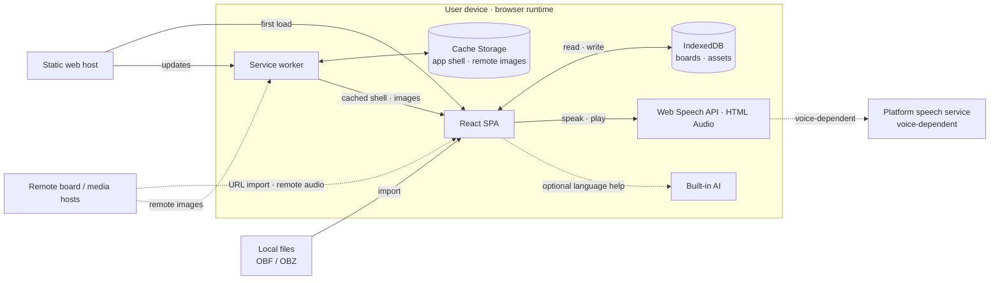

# Architecture

AAC Board AI is a device-local progressive web app (PWA) for people who cannot
rely on speech. Users select tiles to compose messages that the browser can
speak. The app uses React, TypeScript, Vite, MUI, and React Router. Built-in AI
provides optional, on-device language help.

Accessibility comes first, followed by offline reliability, privacy,
responsiveness, and internationalization.

See [README.md](../README.md) for product details and setup,
[AGENTS.md](../AGENTS.md) for contribution and testing rules,
[behavior.md](behavior.md) for how each flow, accessibility rule, and layout
rule works, and the [glossary](#glossary) for AAC terms.

- [Invariants](#invariants)
- [Runtime architecture](#runtime-architecture)
- [Data and state ownership](#data-and-state-ownership)
- [Module boundaries and code map](#module-boundaries-and-code-map)
- [Core flows](#core-flows)
- [Current limitations](#current-limitations)
- [Glossary](#glossary)

## Invariants

A change that breaks one of these rules needs a decision, not just a passing
build. Each links to the section that explains it.

- **Core communication never depends on an optional feature.** People rely on
  the app to communicate, so reading, navigating, and composing with a loaded
  board need neither built-in AI nor the network. Speaking needs only a voice
  that is on the device ([Runtime architecture](#runtime-architecture)).
- **No backend, telemetry, or tracking.** Boards, settings, and the message
  being composed are stored only on the device. Beyond its own static host, the
  network is used only for a board link the user confirmed, remote media a
  board points at, a voice that speaks through an online service, and the
  browser's download of a built-in AI model
  ([Runtime architecture](#runtime-architecture),
  [Start at `/`](behavior.md#start-at-)).
- **Dependencies run one way.** The app composes features, the board imports
  the library, and shared code imports from neither the app nor a feature
  ([Module boundaries](#module-boundaries-and-code-map)).
- **Only `library/storage/` touches IndexedDB, and only `board/suggestions/`
  and `library/translation/` use built-in AI.** Oxlint enforces both
  ([Module boundaries](#module-boundaries-and-code-map)).
- **Stored boards keep their OBF structure.** The runtime `Board` is derived on
  each read, and loading never changes the stored record
  ([Data and state ownership](#data-and-state-ownership)).
- **Board route loaders only read.** They never translate or wait on a model.
  Only the loader for `/` writes, importing the starter board set into an empty
  library ([Open a board](behavior.md#open-a-board),
  [Start at `/`](behavior.md#start-at-)).
- **`useMessage` is the one owner of how the message changes.** Tiles,
  shortcuts, and suggestions all edit the message through it
  ([Activate a tile](behavior.md#activate-a-tile)).
- **Shared playback owns all device output and reads no settings store.** The
  board playback adapter is the only place that reports a failed playback
  ([Data and state ownership](#data-and-state-ownership),
  [Activate a tile](behavior.md#activate-a-tile)).
- **An error is reported where it stops.** A catch that keeps an error from
  travelling further passes it to `reportError`, because the message on screen
  never names the cause. The few exceptions are listed with the rule
  ([Report failures](behavior.md#report-failures)).
- **Speech follows the text, not the setting.** A message part whose language
  is known is spoken in that language
  ([Language and direction](behavior.md#language-and-direction)).
- **A populated grid has one Tab stop.** Arrow keys move inside it, and
  horizontal movement follows text direction
  ([Accessibility](behavior.md#accessibility)).
- **Scanned controls hold no scanning code.** The scanner reads scan groups
  from the DOM, so the grid and its tiles know nothing about scanning
  ([Switch scanning](behavior.md#switch-scanning)).

## Runtime architecture

The app is a single-page application (SPA) with no application backend, telemetry,
or tracking. Keeping boards on-device protects communication content and supports
use on restricted networks; the trade-off is no built-in cross-device sync.

A static host serves the app and updates. The service worker caches the app shell
after the first successful load and third-party images as they are displayed.
Once the shell and board are available locally, core communication works offline.
Playback depends on locally available media and speech voices. Storing a board
set asks the browser for persistent storage, so boards are not evicted when the
device runs low on space; browsers may prompt or decline, and the app works
either way.

Dashed edges mark optional or platform-dependent integrations.

Built-in AI runs on-device without per-request network access once a model is
available.

## Data and state ownership

State has distinct owners and lifetimes:

| State                 | Owner                                 | Contents                                                                                               |
| --------------------- | ------------------------------------- | ------------------------------------------------------------------------------------------------------ |
| Durable board data    | IndexedDB through board storage       | Board-set metadata, source OBF records, and asset bytes                                                |
| Active board          | React Router loaders                  | Stored `Board`, and its set's board list and root board, for the current route                         |
| Asset URLs            | Board storage                         | One object URL per loaded asset, kept until board set deletion or page close                           |
| Navigation history    | React Router                          | Browser history of the boards visited                                                                  |
| Reactive shared state | `createExternalStore`                 | Board-set library, board-set downloads, board translation status, voice catalog, and playback progress |
| Persisted preferences | `createPersistedStore` + localStorage | Language, speech, tile and message display, switch scanning, suggestion instructions, onboarding       |
| Message draft         | `useMessage` + localStorage           | The message being composed, restored by the board loader when the board opens again                    |
| Interaction state     | Local React state                     | Message undo history and remembered grid focus                                                         |

Stored boards retain their OBF structure for AAC compatibility, preserving
imported fields while adding translations saved on this device. Board links
carry the linked board's ID, which the OBF library resolves from the archive.
Board-set records store the set's translated names. `obfToBoard` derives the
runtime `Board` on each read, so runtime types can evolve without rewriting
stored records. The storage schema in
[`boards-db.ts`](../src/features/library/storage/boards-db.ts) has no migrations
yet: a schema change edits it in place, and a browser holding a database from
another schema or version needs its site data cleared. Until then every load
fails, and the error it reports names the mismatch.

React Context provides theme, playback controls, and snackbar access.
Components subscribe to external stores through `useExternalStore`, a
`useSyncExternalStore` wrapper that takes an optional selector.

Playback uses slice subscriptions: each component tracks only the progress fields
it needs. Word-boundary updates rerender only components whose selected fields
change.

Device output does not read settings stores. `AppProviders` gives the playback
coordinator a `getSpeechParameters` function, and the coordinator calls it for
each speech step with the language of the step's text, so every utterance uses
that language's voice and the rate, pitch, and volume current at that moment.

The board-set library broadcasts changes so other tabs can refresh their lists.
Preferences managed by `createPersistedStore` reload when another tab writes
their key, through the window `storage` event. A reload does not write the value
back: only a change made in a tab writes, so tabs running different app versions
cannot keep rewriting each other's value. MUI persists and synchronizes theme
mode separately.

Stores are module singletons that start working when first imported, so they
need no provider and their loading starts before React renders. The cost is that
a store outlives a test, so tests reset the state behind it. The shared [test
setup](../src/shared/testing/setup.ts) clears localStorage and calls
`reloadPersistedStores` before each test. Tests that touch stored boards call
`resetBoardsDB` from the library's
[`testing`](../src/features/library/testing/index.ts) entry, which empties
IndexedDB and refreshes the board-sets store.

## Module boundaries and code map

Cross-boundary imports use path aliases. Oxlint enforces these dependency rules
for aliased imports:

- `src/shared/` is the leaf layer and does not import from app or features.
- Each directory directly under `src/features/` is a feature. It imports shared
  code, its own relative modules, and the public entry points of the features
  it is allowed to depend on, but never app or another feature's
  internals.
- `src/app/` composes features through public entry points such as
  [`src/features/board/index.ts`](../src/features/board/index.ts).
- Only the library's [`storage/`](../src/features/library/storage/) and its
  [test database helper](../src/features/library/testing/db.ts) import `idb` or
  use the `indexedDB` global, so every other module reaches stored boards
  through the library's public entry point.
- Only the board's [`suggestions/`](../src/features/board/suggestions/) and the
  library's [`translation/`](../src/features/library/translation/) import the
  built-in AI package, so nothing else can come to depend on a model.

There are two features, and the dependency runs one way: the board imports the
library's public entry point, and the library imports no feature.

| Feature                               | Owns                                                                             |
| ------------------------------------- | -------------------------------------------------------------------------------- |
| [`board`](../src/features/board/)     | Using a board: grid, tiles, message, suggestions, activation, playback, scanning |
| [`library`](../src/features/library/) | Stored board sets                                                                |

Test files may also import the library's
[`testing`](../src/features/library/testing/index.ts) entry.

The library owns the runtime `Board` types, in
[`board-types.ts`](../src/features/library/board-types.ts), because it builds
them from imported files; the board reads them through the public entry point.
The library also owns the URL scheme, in
[`board-paths.ts`](../src/features/library/board-paths.ts), which says why.

Inside a feature, folders group related code and collaborate through relative
imports; they are not separate boundaries. The library's folders still depend
in one direction, so a folder's name tells which layer it is in:

1. `obf/` is everything the library knows about the board file format, and
   imports no other library folder.
2. `storage/` persists what it is given. It imports only `obf/`, for the shape
   of what it stores and for changes that must happen inside a write, such as
   adding a language's strings to a stored board.
3. `board-sets/` keeps the reactive list of stored sets and reads their boards,
   and the translations they already have, through `storage/` and `obf/`.
4. `import/`, `export/`, and `translation/` build on those.
5. `catalog/` downloads through `import/`.
6. `panel/` is the library's UI and may use all of the above.

### Features

Start with `communication-board.tsx` to follow the board UI. Paths in this table
are relative to `src/features/`.

| Area                   | Source                                                                                           | Responsibility                                                                                        |
| ---------------------- | ------------------------------------------------------------------------------------------------ | ----------------------------------------------------------------------------------------------------- |
| Board interaction      | [board/communication-board.tsx](../src/features/board/communication-board.tsx)                   | Compose the board UI and interaction adapters.                                                        |
| Board playback         | [board/playback/](../src/features/board/playback/)                                               | Plan board playback and highlighting; delegate device output to shared code.                          |
| Switch scanning        | [board/scanning/](../src/features/board/scanning/)                                               | Scan the board's controls with one or two switches; own scanning preferences.                         |
| Suggestions            | [board/suggestions/](../src/features/board/suggestions/)                                         | Offer proofread and rewritten phrasings of the message; own suggestion instructions.                  |
| Import and OBF mapping | [library/import/](../src/features/library/import/), [library/obf/](../src/features/library/obf/) | Unify imports and map OBF records to runtime types.                                                   |
| Export                 | [library/export/](../src/features/library/export/)                                               | Package a stored board set as an OBZ file.                                                            |
| Board persistence      | [library/storage/](../src/features/library/storage/)                                             | Own all production IndexedDB access.                                                                  |
| Stored board sets      | [library/board-sets/](../src/features/library/board-sets/)                                       | Maintain the reactive library and read stored boards as runtime types, in the communication language. |
| Board set catalog      | [library/catalog/](../src/features/library/catalog/)                                             | List the catalog's board sets and track their downloads.                                              |
| Library panel          | [library/panel/](../src/features/library/panel/)                                                 | Show stored and downloadable board sets with their info, export, and delete actions.                  |
| Board translation      | [library/translation/](../src/features/library/translation/)                                     | Translate board sets that lack the communication language.                                            |

### App and shared code

Paths in this table are relative to `src/`.

| Area                   | Source                                                                                                                                                 | Responsibility                                            |
| ---------------------- | ------------------------------------------------------------------------------------------------------------------------------------------------------ | --------------------------------------------------------- |
| App composition        | [main.tsx](../src/main.tsx), [app/](../src/app/), [shared/providers/](../src/shared/providers/)                                                        | Assemble providers, shell, routing, and features.         |
| Device output          | [shared/playback/](../src/shared/playback/)                                                                                                            | Own all Web Speech and HTML Audio output.                 |
| Communication language | [shared/language/](../src/shared/language/), [shared/speech/](../src/shared/speech/)                                                                   | Coordinate communication language and voice selection.    |
| Theme and direction    | [shared/theme/](../src/shared/theme/)                                                                                                                  | Apply theme and directional styling.                      |
| Shared stores          | [shared/stores/external-store.ts](../src/shared/stores/external-store.ts), [shared/stores/persisted-store.ts](../src/shared/stores/persisted-store.ts) | Provide subscription and settings persistence primitives. |

At the repository root, [messages/](../messages/) holds UI catalogs and
[project.inlang/](../project.inlang/) configures Paraglide, which compiles them into
generated `src/paraglide/` modules.

### Companion packages

The app delegates OBF/OBZ parsing to
[`@shayc/open-board-format`](https://github.com/shayc/open-board-format) and browser
AI availability, provisioning, and session lifecycle to
[`@shayc/react-built-in-ai`](https://github.com/shayc/react-built-in-ai).

### Settings composition

The [settings drawer](../src/app/settings/settings-drawer.tsx) composes
[tile settings](../src/features/board/tile/tile-settings.tsx),
[message settings](../src/features/board/message/message-settings.tsx),
[suggestion settings](../src/features/board/suggestions/suggestion-settings.tsx), and
[scanning settings](../src/features/board/scanning/scanning-settings.tsx)
through feature public entry points. The app owns headings, order, layout, and
drawer behavior; features own controls, capability checks, and persisted
preferences. The drawer is modal but does not dim the page, so tile settings are
judged on the board behind it; a line marks its inner edge instead. App-wide
language, theme, and speech settings live in `app/settings/`; language settings
render the library's
[board translation notice](../src/features/library/translation/board-translation-notice.tsx)
instead of checking translation progress themselves.
Reusable field controls live in `shared/ui/` so features do not depend on the
app layer.

Icons are Material Symbols Rounded at the default weight and the 24px optical
size, kept as MUI icon components in
[`shared/ui/icons.tsx`](../src/shared/ui/icons.tsx). Add a missing icon there
instead of importing another icon package.

Closing or unmounting settings does not delete preferences. Removing a feature
requires an explicit decision about retaining or deleting its persisted
preferences.

## Core flows

One line per flow; [behavior.md](behavior.md#core-flows) describes each in
full.

- **[Start at `/`](behavior.md#start-at-):** a board link the user confirmed is
  imported; otherwise the newest stored board set opens, or the starter board
  set is imported into an empty library.
- **[Import board files](behavior.md#import-board-files):** file selection,
  drag and drop, URL imports, and PWA file handling all use `importBoardFile`,
  and each file becomes its own board set.
- **[Export a board set](behavior.md#export-a-board-set):** `boardSetToOBZ`
  packages one set's stored OBF records and assets as an OBZ file.
- **[Open a board](behavior.md#open-a-board):** the route loaders read the
  stored OBF, map it through `obfToBoard`, and restore the message draft, and
  the page shows the board in the communication language.
- **[Translate board sets](behavior.md#translate-board-sets):** the app shell
  translates the sets that lack the communication language and revalidates
  the one on screen.
- **[Activate a tile](behavior.md#activate-a-tile):** `activateTile` opens a
  linked board, adds the tile to the message and plays it unless a message
  setting keeps tiles silent, or runs the tile's actions.
- **[Suggest a message](behavior.md#suggest-a-message):** the Proofreader and
  Rewriter offer phrasings of the message, and selecting one replaces it.

## Current limitations

- **Older browsers are not supported.** The app targets the current versions of
  Chrome, Edge, Firefox, and Safari
  ([Baseline Newly available](https://web.dev/baseline)). Tile colors are
  computed in CSS with relative colors and `contrast-color()`, with no fallback.
  A browser without relative colors shows tiles without their colors, and one
  without `contrast-color()` does not pick a label color that contrasts with the
  tile.
- **AI availability varies.** Support depends on browser, hardware, model
  installation, and language.
- **Boards cannot be edited or synced.** There is no editor or cross-device
  sync. Moving boards between devices means exporting each board set as an OBZ
  file and importing it on the other device.
- **Speech may use external services.** Offline availability and privacy depend
  on the selected voice.
- **Remote media has limited offline support.** Cached third-party images may be
  evicted under storage pressure. Third-party audio remains network-dependent
  because the current cache strategy cannot reliably serve range requests using
  opaque cross-origin responses.

## Glossary

- **AAC** — Augmentative and Alternative Communication: tools for people who
  cannot rely on speech.
- **OBF / OBZ** — Open Board Format: a single board (`.obf`, JSON) or a zipped
  board set with assets (`.obz`).
- **Board** — a grid of communication tiles.
- **Board set** — a collection of linked boards with a root board, imported as a
  unit.
- **Root board** — the board a set opens on, named after the OBF root. Only data
  calls it the root board; navigation and the interface call it Home, after the
  OBF `:home` action, and going to it "Go home".
- **Library** — the board sets stored on this device, listed alongside the
  catalog of board sets that can be downloaded.
- **Symbol** — an AAC representation displayed on a tile or in the message bar:
  an image, a written label, or both.
- **Tile** — an interactive board button containing a communication symbol. It
  adds to the message, navigates to a linked board, or runs an action.
- **Button** — the data model behind a tile, named after the OBF button. Code uses
  `BoardButton` for the data and `Tile` for the view.
- **Vocalization** — the text a tile speaks when it differs from its visible label.
- **Board strings** — a board's translatable text: its name and each tile's label
  and vocalization. OBF keeps their translations in `strings`, one map per locale.
- **Message bar** — the area showing selected symbols that form the message to
  speak.
- **Message part** — one item in the message. A tile part comes from a tile,
  with its label and any vocalization, image, or sound, and backspace removes it
  whole. A text part is a word that was spelled or taken from a suggestion, and
  backspace removes one character at a time. Spelling extends the last text part
  until a space or another tile closes the word; the first backspace on a closed
  word reopens it. During spelling, the message bar shows a caret at the end of
  an open word or after the space that follows a closed word.
- **Message draft** — the message being composed, saved on the device on every
  change so it survives a reload or an app restart. The board opens with it.
- **Page margin** — the space between the screen's edges and the board's
  content, and between one bar and the next.
- **Scroll clearance** — the room kept above and below the grid, between the
  tiles scrolling past and a bar's controls or the screen's edge.
- **Overflow hint** — the part of the next row or column that shows past the
  grid's edge, so the user can tell the board scrolls that way.
- **Inset** — the part of the grid's viewport that whole rows or columns leave
  free: padding, plus a tile gap and the overflow hint where the grid scrolls.
- **Built-in AI** — browser-provided on-device Proofreader, Rewriter, and
  Translator APIs used for grammar, tone, and translation.
- **TTS** — text-to-speech through the browser's Web Speech API.

### Terms with more than one meaning

- **Message** — what the user composes from tiles and plays aloud, in
  [`features/board/message/`](../src/features/board/message/). The UI text
  catalogs in [`messages/`](../messages/), which code reads as `m.someKey`, are
  unrelated.
- **Report** — telling the person that something failed, in a snackbar or on
  the error page, names what failed. Reporting an error, through the browser's
  `reportError`, records why in the console for whoever investigates
  ([Report failures](behavior.md#report-failures)).
- **Translation** — UI text comes from the Paraglide message catalogs and is
  read through `useTranslate()`. Board translation is separate: it shows board
  strings in the communication language, reading the translations a board
  already has in
  [`board-in-language.ts`](../src/features/library/board-sets/board-in-language.ts)
  and producing missing ones with the Translator API in
  [`translate-board-sets.ts`](../src/features/library/translation/translate-board-sets.ts).
- **Store and storage** — a store is reactive state that components subscribe
  to, held in memory or persisted to localStorage. Storage is IndexedDB, reached
  only through [`library/storage/`](../src/features/library/storage/). The
  [board-sets store](../src/features/library/board-sets/board-sets-store.ts)
  sits on top of storage: `addBoardSet` and `deleteBoardSet` call storage's
  `insertBoardSetRecords` and `deleteBoardSetRecords`, then refresh the store
  and notify other tabs. Storage functions name the records they touch; store
  functions name the board set.
- **Playback** — speaking text or playing recorded audio.
  [`shared/playback/`](../src/shared/playback/) owns device output and progress;
  [`features/board/playback/`](../src/features/board/playback/) turns message
  parts into the steps to play and reports a playback that fails.
- **Navigation** — moving between boards with Home and the board selector,
  in [`features/board/navigation/`](../src/features/board/navigation/).
  Moving focus between tiles is the grid's
  [keyboard navigation](../src/features/board/grid/grid-key-navigation.ts), and
  matching URLs to pages is [`app/routing/`](../src/app/routing/).
