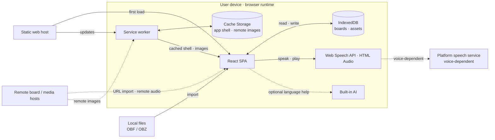

# Architecture

AAC Board AI is a device-local PWA for people who cannot rely on speech. Users
select tiles to compose messages that the browser can speak. The app uses React,
TypeScript, Vite, MUI, and React Router, with optional on-device Built-in AI.

This guide covers module boundaries, state ownership, and key decisions. See
[README.md](../README.md) for product details and setup,
[AGENTS.md](../AGENTS.md) for contribution and testing rules, and the
[glossary](#glossary) for AAC terms.

Accessibility comes first, followed by offline reliability, privacy,
responsiveness, and internationalization. Users depend on the app to communicate,
so optional capabilities must never become requirements for reading, navigating,
or composing with a loaded board.

- [Runtime architecture](#runtime-architecture)
- [Module boundaries and code map](#module-boundaries-and-code-map)
- [Data and state ownership](#data-and-state-ownership)
- [Core flows](#core-flows)
- [Accessibility, language, and presentation](#accessibility-language-and-presentation)
- [Current limitations](#current-limitations)
- [Glossary](#glossary)

## Runtime architecture

The app is one React SPA with no application backend, telemetry, or tracking.
IndexedDB is the source of truth for imported boards. Keeping the core on the
device protects communication content and supports use on restricted networks;
the trade-off is no built-in cross-device sync.

A static host serves the app and updates. The service worker caches the app shell
after a successful first load and third-party images after they are displayed.
Once the shell and board data have loaded, core communication works offline, with
playback depending on locally available media and speech voices.

Dashed edges mark optional or platform-dependent integrations. URL imports and
remote media contact their source hosts; some speech voices use external
services. The app does not send board or message content to an application
service.

Built-in AI processes content on-device, without per-request network access once
a model is available. Availability is capability-detected rather than inferred
from User-Agent strings.

## Module boundaries and code map

Cross-boundary imports use path aliases, with these dependency rules enforced by
Oxlint for aliased imports:

- `src/shared/` is the leaf layer and does not import from app, pages, or features.
- Each directory directly under `src/features/` is an isolated feature. It imports
  shared code and its own relative modules, but not app, pages, or other features.
- `src/app/` and `src/pages/` compose features through public entry points such as
  [`src/features/board/index.ts`](../src/features/board/index.ts).

Folders inside the board feature group code that changes together and may
collaborate through relative imports. They do not need separate public entry
points or dependency rules.

Start with
[`communication-board.tsx`](../src/features/board/communication-board.tsx) to
follow the board UI. Links point to source locations; board feature folders omit
the `src/features/board/` prefix below.

| Area                      | Owner                                                                                                                    | Responsibility                                                      |
| ------------------------- | ------------------------------------------------------------------------------------------------------------------------ | ------------------------------------------------------------------- |
| App composition           | [main.tsx](../src/main.tsx), [app/](../src/app/), [pages/](../src/pages/), [shared/providers/](../src/shared/providers/) | Assemble providers, shell, routing, and features.                   |
| Board interaction         | [communication-board.tsx](../src/features/board/communication-board.tsx)                                                 | Compose the board UI and interaction adapters.                      |
| OBF mapping               | [obf/](../src/features/board/obf/)                                                                                       | Map OBF records and actions to runtime types.                       |
| Board import              | [import/](../src/features/board/import/)                                                                                 | Unify file, drop, URL, and PWA imports.                             |
| Board persistence         | [storage/](../src/features/board/storage/)                                                                               | Own all production IndexedDB access.                                |
| Board-set catalog         | [board-sets/](../src/features/board/board-sets/)                                                                         | Maintain the reactive catalog; creates and deletes pass through it. |
| Board playback            | [playback/](../src/features/board/playback/)                                                                             | Plan playback and highlighting; delegate device output.             |
| Optional language help    | [suggestions/](../src/features/board/suggestions/), [translation/](../src/features/board/translation/)                   | Set AI preparation, instruction, and language policy.               |
| Device output             | [shared/playback/](../src/shared/playback/)                                                                              | Own all Web Speech and HTML Audio output.                           |
| Speech configuration      | [shared/speech/](../src/shared/speech/)                                                                                  | Discover voices and coordinate speech settings with language.       |
| Language and presentation | [shared/language/](../src/shared/language/), [shared/theme/](../src/shared/theme/)                                       | Coordinate language, direction, and theme.                          |
| Shared stores             | [external-store.ts](../src/shared/utils/external-store.ts), [persisted-store.ts](../src/shared/utils/persisted-store.ts) | Provide subscription and settings persistence primitives.           |
| UI messages               | [messages/](../messages/), [project.inlang/](../project.inlang/) (repository root)                                       | Compile catalogs to generated `src/paraglide/`.                     |

Two companion packages own reusable mechanics:
[`@shayc/open-board-format`](https://github.com/shayc/open-board-format) parses
and creates OBF/OBZ files, while
[`@shayc/react-built-in-ai`](https://github.com/shayc/react-built-in-ai) manages
browser AI availability, provisioning, and lifecycle. The app adds product policy
around both interfaces.

## Data and state ownership

State is owned according to its lifetime:

| Lifetime              | Owner                                 | Contents                                                                      |
| --------------------- | ------------------------------------- | ----------------------------------------------------------------------------- |
| Durable board data    | IndexedDB through board storage       | Board-set metadata, source OBF records, and image/sound asset blobs.          |
| Active board          | React Router loaders                  | The hydrated, optionally translated `Board` for the current route.            |
| Navigation history    | React Router `location.state`         | The bounded board back-stack.                                                 |
| Reactive shared state | `createExternalStore`                 | Board-set catalog, voice catalog, and playback progress.                      |
| Persisted settings    | `createPersistedStore` + localStorage | Language, speech, board preferences, suggestion instructions, and onboarding. |
| Interaction state     | Local React state                     | In-progress message parts and remembered grid focus.                          |

Open Board Format keeps imports compatible with the AAC ecosystem. Stored boards
remain OBF-shaped, preserving imported fields while resolving board links and
adding cached translations. `obfToBoard` derives the runtime `Board` on each read.
This mapping layer lets the runtime shape evolve without rewriting imported
records. Storage schema changes still require a versioned migration in
[`boards-db.ts`](../src/features/board/storage/boards-db.ts).

The board-set catalog broadcasts changes across tabs so each tab can refresh its
list. Settings managed by `createPersistedStore` do not synchronize across tabs.
MUI persists and synchronizes theme mode separately.

React Context carries language, theme, playback controls, and snackbar access.
React subscribes to external stores through `useSyncExternalStore`. Playback
progress uses slice subscriptions so word-boundary updates rerender only
consumers of the changed slice.

## Core flows

At the root route, an explicit `?board=` URL takes precedence. Otherwise, the app
opens the first stored board set or imports the bundled starter board when the
catalog is empty. File picker, drop, URL, and PWA file-handler imports converge on
`importBoardSets`; each import creates a separate board set.

### Open a board

The active board enters the render tree through
[`boardLoader`](../src/app/routing/loaders/board-loader.ts), keeping hydration and
translation orchestration out of components:

1. Navigation to `/sets/:setId/boards/:boardId` calls `hydrateBoard`, which reads
   the stored OBF and assets, creates provisional media object URLs, and maps the
   result through `obfToBoard`.
2. `resolveBoardForLanguage` uses the source language or an existing translation
   when possible. Otherwise, it attempts optional translation and returns the
   source board on failure. A successful translation is ready to render without
   waiting for its best-effort cache write.
3. The route renders the ready `Board`. The app shell's
   [media lifecycle observer](../src/app/routing/use-board-route-media-lifecycle.ts)
   commits its media and disposes the previous board's media.

Media ownership follows the route: failed or aborted loads dispose only their
own provisional URLs, and leaving the board route releases committed URLs.

### Activate a tile

[`activateButton`](../src/features/board/activation/button-activation.ts) connects
the message, navigation, and playback owners:

1. A tile linking to another board navigates immediately. A tile without actions
   appends a message part and plays it. Other tiles apply their actions in order.
2. A speak action captures the message at that point. Later mutations, such as
   clearing it, commit only after uninterrupted playback completes. This keeps
   the spoken message visible and preserves it when playback is interrupted.
3. The board playback adapter calls `planPlayback` to turn message parts into
   speech and recorded-audio steps. The shared coordinator plays them in order
   and publishes progress for highlighting.

Playback is exclusive across the app: a new request interrupts the current one.
Interruption is expected and does not surface as a user error.

## Accessibility, language, and presentation

Interactive controls have programmatic names and support pointer and keyboard
input. The [board grid](../src/features/board/grid/grid.tsx) and its
[keyboard behavior](../src/features/board/grid/use-grid-keyboard.ts) preserve
these interaction rules:

- A populated grid has one Tab stop, at the remembered tile or first occupied
  cell.
- Arrow keys move between focusable cells; horizontal movement follows text
  direction.
- When grid content changes, focus returns to the remembered cell or first
  focusable tile only if no other control holds focus.

Behavior tests run in real Chromium through Playwright-backed Vitest, alongside
axe-core accessibility checks.

One communication language coordinates UI locale, board translation, text
direction, and TTS selection. Choices combine translated UI locales with
available TTS voice languages; UI, translation, and speech can fall back
independently. A selectable language therefore does not guarantee a matching
voice or an available translation model.

UI text comes from Paraglide message catalogs. Direction-specific Emotion caches,
RTL styling, and logical CSS support both text directions. The [glossary](#glossary)
keeps domain terms consistent across visible text and accessible labels.

Theme colors share one source in
[`theme-colors.ts`](../src/shared/theme/theme-colors.ts). Theme mode applies before
the first paint.

## Current limitations

- **AI availability varies.** Browser support, hardware, model installation,
  and language support constrain optional language help.
- **Boards are import-only.** There is no board editor, export, or cross-device
  sync. Moving boards between devices requires the original OBF/OBZ files;
  cached translations cannot yet be exported.
- **Speech locality depends on the platform.** Voices are not restricted to
  local services, so offline availability and privacy behavior depend on the
  selected voice.
- **Remote media is best-effort offline content.** Cached third-party images may
  be evicted under storage pressure. Third-party audio remains network-dependent:
  playback may use range requests that opaque cross-origin responses cannot
  reliably satisfy with the current cache strategy.

## Glossary

- **AAC** — Augmentative and Alternative Communication: tools for people who
  cannot rely on speech.
- **OBF / OBZ** — Open Board Format: a single board (`.obf`, JSON) or a zipped
  board set with assets (`.obz`).
- **Board** — a grid of communication tiles.
- **Board set** — a collection of linked boards with a root board, imported as a
  unit.
- **Symbol** — an AAC representation displayed on a tile or in the message bar:
  an image, a written label, or both.
- **Tile** — an interactive board button containing a communication symbol. It
  adds to the message, navigates to a linked board, or runs an action.
- **Vocalization** — what a button speaks when it differs from the visible label.
- **Message bar** — the selected symbols accumulated into the message to speak.
- **Built-in AI** — browser-provided on-device Proofreader, Rewriter, and
  Translator APIs used for grammar, tone, and translation.
- **TTS** — text-to-speech through the browser's Web Speech API.

---

_Owner: @shayc · Update this map when module boundaries, state ownership, or key
architectural decisions change._
